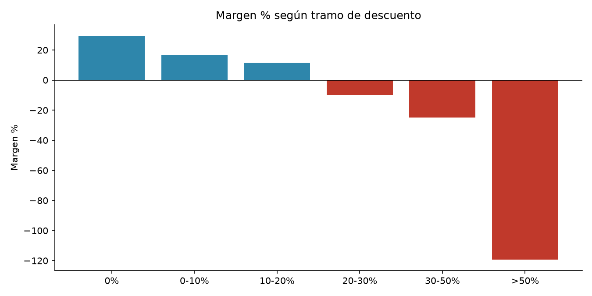

# ¿Dónde se pierde rentabilidad? Análisis de Superstore Sales

> **Resultado principal:** _(completa tras el análisis, ej. "El 30% de las líneas vende con pérdida; con descuentos sobre 20% el margen es negativo")_



## Problema de negocio
La gerencia comercial quiere saber qué categorías, productos y descuentos reducen la utilidad, y qué acciones tomar.

## Datos
Superstore Sales, Kaggle (enlace a la fuente). ~10.000 líneas de pedido: ventas, descuento, utilidad, categoría, región y fechas.

## Método
1. Carga y revisión de calidad (duplicados, fechas, nulos) con pandas.
2. KPI: ventas, utilidad, margen %, pedidos, ticket promedio.
3. Rentabilidad por categoría, sub-categoría, región y tramo de descuento.
4. Consultas SQL equivalentes sobre SQLite (`sql/consultas.sql`).
5. Dashboard en Power BI con las tablas exportadas _(opcional, ver `dashboards/`)_.

## Hallazgos y recomendaciones
_(3 hallazgos con cifras y 2 o 3 recomendaciones accionables)_

## Cómo reproducirlo
```bash
pip install -r requirements.txt
# descarga el CSV a data/raw/ (ver data/README.md)
python src/cargar_a_sqlite.py "data/raw/Sample - Superstore.csv"
jupyter notebook notebooks/01_analisis_rentabilidad.ipynb
```

## Estructura
```
notebooks/   análisis narrado
sql/         consultas de negocio
src/         carga a SQLite
reports/     tablas y gráficos exportados
dashboards/  capturas o PDF de Power BI
```

## Autor
Kevin Labra · [LinkedIn](https://linkedin.com/in/klabras)
