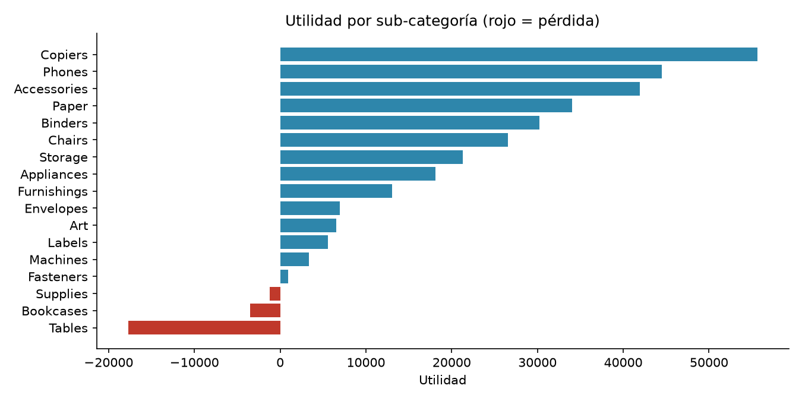

# ¿Dónde se pierde rentabilidad? Análisis de Superstore Sales

> **Resultado principal:** los descuentos superiores al 20 % generaron pérdidas por **USD 135 mil**, el **47 % de la utilidad total**. Un tope de descuento podría mejorar la utilidad entre **47 % y 77 %** (simulación).


## Problema de negocio
La gerencia comercial de una cadena minorista quiere saber qué categorías, productos, regiones y niveles de descuento reducen la utilidad, y qué acciones tomar.

## Datos
Dataset de ejemplo **Superstore Sales**: [Kaggle](https://www.kaggle.com/datasets/vivek468/superstore-dataset-final), originado en una [muestra pública de Tableau](https://community.tableau.com/s/question/0D54T00000CWeX8SAL/sample-superstore-sales-excelxls). Incluye 9.994 líneas de pedido de una tienda de EE. UU. (montos en USD). Es un conjunto con fines educativos, no datos de una empresa real, y **no se incluye en este repositorio**.

## KPI generales
| Ventas | Utilidad | Margen | Pedidos | Ticket promedio | Líneas con pérdida |
|---|---|---|---|---|---|
| USD 2,30 M | USD 286 mil | 12,5 % | 5.009 | USD 458,61 | 18,7 % |

## Hallazgos
1. **Furniture** aporta el 32 % de las ventas pero solo el 6 % de la utilidad (margen 2,5 % vs ~17 % en las otras categorías). Tables, Bookcases y Supplies operan con pérdida.
2. Con **descuentos superiores al 20 %** el margen se vuelve negativo (de -10 % a -119 %). Esas 1.393 líneas (14 % del total) generaron pérdidas por USD 135 mil.
3. Las pérdidas por descuentos altos se reparten en las tres categorías (Furniture 40 %, Office Supplies 35 %, Technology 25 %): es un problema de política de descuentos, no solo de mezcla de productos.
4. La región **Central** opera con 24 % de descuento promedio y 7,9 % de margen, frente a 11 % y 14,9 % en West.
5. Los 10 productos más perdedores acumulan USD 29 mil de pérdida; 4 son mesas y 2 son impresoras 3D.



## Recomendaciones e impacto estimado
| Prioridad | Recomendación | Impacto estimado en utilidad |
|---|---|---|
| 1 | Tope de descuento de 20 %, con aprobación gerencial sobre ese nivel | +USD 135 mil (+47 %) en el escenario más conservador; hasta +USD 219 mil (+77 %) si se mantienen todas las ventas |
| 2 | Alinear los descuentos de Central con los de West | ~USD 35 mil (+12 %) |
| 3 | Renegociar o discontinuar los 10 productos más perdedores | ~USD 29 mil (+10 %) |
| 4 | Revisar costo y precio de Tables, Bookcases y Supplies | ~USD 22 mil (+8 %) |

*Los impactos se solapan entre sí y no deben sumarse.*

**Supuestos:** la columna `Sales` ya incluye el descuento y el costo de cada línea no cambia con él. El escenario conservador (perder todas las ventas con descuento alto) no depende de la reacción de los clientes; la simulación no modela costos fijos.

## Método
1. Carga y revisión de calidad con pandas: duplicados, fechas y valores vacíos (sin hallazgos).
2. Cálculo de KPI: ventas, utilidad, margen, pedidos y ticket promedio.
3. Rentabilidad por categoría, sub-categoría, región, producto y tramo de descuento.
4. Simulación de escenarios de política de descuentos con análisis de sensibilidad.
5. Validación Cruzada: las mismas métricas se replican en SQL (SQLite) con resultados coincidentes (sql/consultas.sql ; resultados en reports/resultados_sql.md)

## Cómo reproducirlo
```bash
python -m pip install --user -r requirements.txt
# descarga el CSV a data/raw/ (ver data/README.md)
python -m notebook notebooks/01_analisis_rentabilidad.ipynb
```

## Estructura
```
notebooks/   análisis narrado
sql/         consultas de negocio (en SQLite)
src/         carga a SQLite y ejecución de consultas
reports/     gráficos y tablas resumen
dashboards/  capturas o PDF de Power BI (próximamente)
```

## Próximos pasos
- Construir un dashboard ejecutivo en Power BI con las tablas de `reports/`.

## Autor
Kevin Labra · [LinkedIn](https://linkedin.com/in/klabras) · [GitHub](https://github.com/Ketrafe)